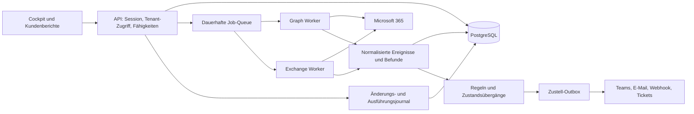

# M365 Config Tool: Funktionsabgleich und Ausbauplan

Stand: 23. Oktober 2026. Basis: öffentlich sichtbare Produktseite, deren FAQ, die bereitgestellten Screenshots und der Quellcode dieses Repositorys. Die konkurrierende Anwendung wurde nicht mit einem Partnerkonto untersucht. Die frühere Aussage „umgesetzt“ bezog sich auf den dokumentierten Cockpit-Ausbau, nicht auf vollständige Funktionsgleichheit.

## Was die Referenz tatsächlich belegt

Die [Produktseite von Fokus MSP](https://fokus-msp.de/en/produkt/fokus-msp-m365-cockpit) beschreibt folgende Produktbereiche. Anbieterangaben wurden nicht als unabhängig gemessene Leistungswerte übernommen.

| Belegter Referenzbereich | Stand in unserem Code nach diesem Ausbau |
| --- | --- |
| Tenant-Onboarding und zentrale Verwaltung | Vorhanden: Zertifikate, Consent, Verbindungsprüfung. Vereinfachter durchgehender Einrichtungsablauf fehlt. |
| Benutzer, Gruppen, MFA, Lizenzen, Offboarding | Teilweise: Inventar, Kontoaktionen, Lizenzanalyse vorhanden. TAP, Kontoklonen und geführter Offboarding-Prozess fehlen. |
| Tenantübergreifende Policy-Blueprints, Geo-Blocking | Zustandsvorlagen vorhanden. Neu: neue Länder-Policies mit geprüften Ausnahmen und Report-only-Rollout. |
| Bedrohungen aus mehreren Microsoft-Datenquellen | Risk-Daten und Korrelation vorhanden. Persistierte inkrementelle Sign-in-Pipeline ergänzt; Security-Alerts/Incidents fehlen. |
| Freigaben in SharePoint und OneDrive bearbeiten | Inventar und Sharing-Ereignisse vorhanden. Vollständige Datei-/Berechtigungssicht und gezielter Widerruf fehlen. |
| App-Risiken und Credential-Ablauf | Rechteanalyse vorhanden. Neu: Credential-Ablauf als reguläre Monitoring-Befunde. App-Deinstallation fehlt. |
| Mandantenübergreifende E-Mail-/Webhook-Alarme | Tenantbezogene Regeln mit Defender-/Entra-Audit-Vorlagen, Alarmzustand und gemeinsamer dauerhafter Teams-Outbox umgesetzt; Live-Abnahme offen. Mehrere Zieltenants je Regel, E-Mail und Eskalationen fehlen. Siehe [ALARMS.md](ALARMS.md). |
| Compliance-Dokumentation und planbare Markenreports | Maßnahmen und Reports vorhanden. Logo-/Modulvorlagen und kontrollierte Report-Zustellung fehlen. |
| Lizenzbestellung über einen Distributionspartner | Nicht implementiert; getrennte kommerzielle Integration erforderlich. |

Quelle dieser Vergleichsbereiche: [Fokus-Produktseite und FAQ](https://fokus-msp.de/en/produkt/fokus-msp-m365-cockpit). Sichtbare Menüpunkte auf Screenshots, etwa Copilot, LAPS oder BitLocker, belegen allein keine vollständigen Abläufe; sie stehen daher separat im Backlog.

## Bewertung

Die vorhandene Basis ist für ein internes MSP-Werkzeug brauchbar: Svelte-Oberfläche, Graph-/Exchange-Anbindung, Best-Practice-Policies, Maester, Drift, Evidence, Inventar und ServiceDesk Plus. Der größte Abstand liegt in der dauerhaften Ausführung und im operativen Durchstich: Ein Befund muss zu einem verantwortlichen Techniker, einer geprüften Änderung, einem nachprüfbaren Ergebnis und einer verständlichen Kundeninformation führen.

Eine weitere Oberfläche ohne diese Verbindung würde den Abstand kaum verkleinern. Die neue Entwicklung sollte diese bestehenden Fachmodule nutzen, ihre APIs vereinheitlichen und schrittweise produktfähige Ausführungs- und Datengrenzen ergänzen.

## Bereits als nächster vertikaler Ausbau implementiert

### Credential-Monitoring

- `api/lib/appCredentials.js` liest Metadaten aus App-Registrierungen und Service Principals. Keine Secret-Werte oder Schlüsselbytes werden ausgegeben.
- Fälligkeiten werden in abgelaufen, bis sieben Tage, bis 30 Tage, gültig und unbekannt eingeteilt. Die Kategorie ist kein Nachweis tatsächlicher Nutzung oder einer bereits eingetretenen Störung.
- Die neue Managed-Service-Area `credentials` nutzt denselben Befund-Lebenszyklus wie die bisherigen Kollektoren. Damit greifen Arbeitsliste, bestehende Benachrichtigung und die lokalen Schwellwertregeln.
- Scheitert eine der beiden Quellen, gilt die gesamte Erhebung als fehlgeschlagen. Bestehende Befunde werden nicht aufgrund einer unvollständigen Liste geschlossen.
- Bestehende explizite Bereichsauswahlen werden nicht geändert. Betreiber müssen den neuen Bereich dort bei Bedarf aktivieren. Standardauswahlen ohne eigene Einschränkung enthalten ihn.

### Geo-Blueprints

- `POST /api/tenants/:id/cockpit/geo/preview` validiert Länder und aktive Mitglieds-Notfallkonten im Zieltenant. Es speichert einen 15 Minuten gültigen, dem Benutzer zugeordneten Plan. Es erzeugt keine Microsoft-Objekte.
- `POST .../geo/apply` akzeptiert nur die Plan-ID. Clientseitig nachgereichte Länder oder Zustände werden nicht ausgeführt. Notfallkonten werden nochmals aufgelöst und gegen die Vorschau geprüft.
- Neue Policies sind immer `enabledForReportingButNotEnforced`. Aktivierung erfolgt später im bestehenden CA-Bereich nach Prüfung der Ergebnisse.
- Im Erlaubnis-Modus werden alle anderen und unbekannte Standorte in der möglichen Blockierung berücksichtigt. Im Sperr-Modus werden nur die gewählten Länder erfasst.
- Eindeutige Planmarker ermöglichen die Wiederaufnahme nach mehrdeutigen Netzwerkfehlern. Existierende Objekte mit abweichendem Inhalt werden nicht übernommen oder verändert.
- Ergebnisse und Teilfehler bleiben mit Objekt-IDs erhalten. Eine Named Location kann bei einem Teilfehler bereits existieren. Es gibt keine behauptete Transaktion über mehrere Microsoft-Objekte oder Tenants.
- Prüfmandate dürfen Vorschauen speichern, aber keine Geo-Policies anlegen. Gleichzeitige Geo-Ausführungen werden derzeit innerhalb eines API-Prozesses je Tenant gesperrt.

Graph-Verträge: [Named Locations erstellen](https://learn.microsoft.com/en-us/graph/api/conditionalaccessroot-post-namedlocations?view=graph-rest-1.0), [CA-Policy erstellen](https://learn.microsoft.com/en-us/graph/api/conditionalaccessroot-post-policies?view=graph-rest-1.0). Der neue Ablauf verwendet vorhandene Zertifikate und Rechte; in dieser Arbeit wurde nichts in einem produktiven Tenant ausgerollt.

## Zielbild: operatives MSP-Cockpit

Dies ist das geplante Zielbild, kein bereits vorhandener Produktionsaufbau.

### Datenmodell

| Modell | Wichtige Felder / Regeln |
| --- | --- |
| tenants | interne ID, Microsoft-Tenant-ID, erlaubte Fähigkeiten, Verbindung, Datenregion |
| operator_tenants | Benutzer/Rolle, erlaubte Tenant-IDs; jede Abfrage serverseitig einschränken |
| sync_cursors | Tenant, Quelle, Cursor/Zeitmarke, letzter vollständig erfolgreicher Lauf, Backoff |
| events | eindeutige Quell-ID, Tenant, Typ, Zeit, Quelle, gekürzter Kontext; Deduplikation je Tenant/Quelle |
| findings | stabiler Schlüssel, Schweregrad, Zustand, Erst-/Letztsichtung, Bearbeiter, Ticket |
| action_plans | geprüfter Payload-Hash, Vorschau, Ziele/Ausnahmen, Ersteller, Ablauf, Freigabe |
| jobs / job_steps | Idempotenzschlüssel, Leasing, Heartbeat, Wiederholungen, Teilergebnisse |
| notification_outbox | Ereignis/Regel/Empfänger, Deduplikationsschlüssel, Versuche, nächste Zustellung |
| audit_entries | Akteur, Tenant, Aktion, Plan-/Job-ID, Ergebnis, Vorher-/Nachher-Referenz |
| report_runs | Vorlage/Version, Tenant, Datenstand, gespeicherte Datei, Zustellstatus |

Rohdaten und große Berichte bleiben in einem getrennten, gesicherten Artefaktspeicher. Zertifikate/Secrets gehören in einen geeigneten Secret Store beziehungsweise verschlüsselte Hostablage, nicht in den UI-Store. Die aktuelle JSON-Ablage wird über ein Repository-Interface zunächst weitergelesen; eine Migration erhält bestehende IDs und Audit-Bezüge.

### Job-Ausführung und Sync

Aktuell umgesetzt: SQLite im vorhandenen persistenten State-Volume, ohne zusätzlichen Datenbankdienst. Die vorangegangene Annahme eines bestehenden Postgres-Betriebs traf auf diese Installation nicht zu. Jobs, Leases, Tenant-Rollen, Journal und Sign-in-Cursor sind jetzt dauerhaft gespeichert. Für mehrere API-Instanzen bleibt PostgreSQL mit geeigneter Queue eine mögliche nächste Migration. Graph und Exchange besitzen unterschiedliche Quellintervalle; eine Trennung in eigene Worker-Pools bleibt ein Skalierungsschritt.

Der Scheduler legt jetzt dauerhafte Jobs an. Allgemeine Graph-Quellen behalten ihr konfiguriertes Intervall; Sign-ins erhalten bei aktivierter Quelle ein Zehn-Minuten-Intervall. Die folgenden Anforderungen sind durch Leases, Quellzustände und zeitbasierten Sign-in-Sync teilweise umgesetzt; eine vollständige Delta-Migration aller Quellen bleibt offen:

- Kleine Ereignisquellen alle fünf bis zehn Minuten; Inventar und teure Berechtigungsauflösungen wesentlich seltener.
- Pro Quelle echte unterstützte Delta-APIs verwenden. Bei Sign-ins zeitbasierte Fenster mit Überlappung und Deduplikation, statt eine nicht vorhandene universelle Delta-API anzunehmen.
- Cursor erst nach vollständig verarbeiteter Pagination fortschreiben. Nach Neustarts oder Fehlern wiederholen, nicht überspringen.
- Tenantbezogene Parallelitätsgrenzen, globale Lastgrenzen und `Retry-After` beachten. Ein gedrosselter Tenant darf andere Mandanten nicht aufhalten.
- Lease/Heartbeat für Worker und klare Zustände wie wartend, läuft, teilweise erfolgreich, fehlgeschlagen, erneut versuchbar.
- Messgrößen: Datenalter je Quelle/Tenant, Queue-Lag, Fehler-/Throttle-Rate, Zustellverzug und Anteil nicht prüfbarer Bereiche.

### Sichere operative Aktionen

Alle schreibenden Abläufe erhalten dasselbe Muster: Ziel wählen → serverseitige Vorschau → konkrete Änderungen prüfen → ausführen → Wirkung erneut lesen → Ergebnis dokumentieren. Für Passwort-/MFA-Aktionen werden bestehende Freigaben erhalten, bis eine explizite Rollen-/Fähigkeitenverwaltung sie ersetzt. Die Bezeichnung „KI-Schreibrechte“ ist für manuelle Technikeraktionen künftig zu trennen, ohne dadurch Rechte zu erweitern.

Offboarding wird kein Alles-oder-nichts-Button: Anmeldung sperren, Sitzungen widerrufen, Postfachübergabe, Aufbewahrung, Gruppen und Lizenzen sind einzelne abhängige Schritte. Lizenzentzug und Löschung folgen erst nach den jeweiligen fachlichen Voraussetzungen. Jeder Schritt benötigt einen definierten Wiederholungs- und Fehlerpfad.

## Priorität 1 des aktuellen Auftrags: Plattformausbau

Implementiert sind dauerhafte Monitoring-Jobs mit zwei parallelen Tenants, Tenant-Rollen mit serverseitigen Grenzen, Quell-Backoff/Datenalter und atomare Sign-in-Cursor nach vollständiger Pagination. Details und Betriebsgrenzen: [PLATFORM-OPERATIONS.md](PLATFORM-OPERATIONS.md). Alte JSON-Artefakte sind noch nicht vollständig migriert, schreibende Alt-Jobs werden nicht automatisch wiederholt. Live-Microsoft-Abnahme und Restore im Zielcluster stehen aus.

Die nachfolgenden P0/P1/P2-Kategorien beschreiben den ursprünglichen Produktplan; die Auftragspriorität oben bezieht sich auf die jetzt umgesetzte Plattformbasis.

## Priorisierter Ausbau

### P0 — Plattform für verlässlichen Betrieb

1. Tenantbezogene Rollen/Fähigkeiten für Lesen, Operieren, Freigeben und Administrieren. Tenant-RBAC ist für freigegebene Routen umgesetzt; übrige ältere Fachmodule bleiben für Mitglieder gesperrt.
2. Dauerhafte Jobs, Audit-Journal und Datenbank-Repositories. Alte JSON-Daten vollständig migrieren und Wiederherstellung testen.
3. Zentraler Fähigkeitsstatus je Tenant: Rechte fehlen, Lizenz fehlt, noch nie gelaufen, Daten veraltet oder betriebsbereit.
4. Integrations-Testtenant und Tests für Consent, Zertifikatsrotation, 403, 429, Neustart, Teilfehler und konkurrierende Jobs.

Abnahme: Ein geplanter Lauf überlebt einen API-Neustart; ein Techniker sieht ausschließlich zugewiesene Tenants; jeder ausgeführte Schritt ist im Journal einem Benutzer oder Dienstlauf zugeordnet.

### P1 — Durchgängige Sicherheitsabläufe

1. Die neuen Credential- und Geo-Abläufe in einem isolierten Microsoft-Testtenant gegenprüfen.
2. Threat Inbox aus Risk Detections, Sign-ins, Defender Alerts/Incidents und Directory Audits; ein gemeinsames Ereignismodell mit Quellbezug.
3. Überwachte Notfall-/Admin-Konten, Credential-Fristen, externe Weiterleitungen, neue weitreichende Consents und konkrete Scope-Änderungen als Regeltypen.
4. Alarmregeln mit mehreren Zieltenants und gemeinsamer Outbox; Alarmzustand, Entwarnung, Cooldown, Deduplikation, Eskalation und Zustellversuche.
5. Notfall-Kontomaßnahmen mit klarer Teilfehleranzeige und anschließender Verifikation.

Abnahme: Ein synthetischer Vorfall wird einmal erkannt, einmal zugestellt und nach Behebung nachvollziehbar geschlossen; ein Wiederholungsversuch erzeugt keine doppelten Tickets.

### P2 — Datenzugriffe und Kundenservice

1. Datei-/Freigabeinventar je Site/Drive mit Einwilligungs-/Auftragskontext, Datenalter und explizit begrenzten Scanbereichen.
2. Gezielter Berechtigungswiderruf anhand von Drive-/Item-/Permission-ID nach Vorschau; übernommene und vererbte Berechtigungen unterscheiden.
3. Gebrandete Reportvorlagen mit Logo, Modulwahl, Datenstand, technischen Details und eigener Kundenzusammenfassung.
4. Zeitpläne, gespeicherte Reportversionen und geprüfte Zustellung; echte XLSX-Exports für tabellarische Auswertungen.
5. Gruppen-, Lizenz- und Benutzerverwaltung als vollständige Abläufe mit Suche, Auswahl, Vorschau und Audit.

### P3 — Breite Produktparität

Teams, Copilot-Auswertung, Service-Health-Ansichten, BitLocker/LAPS-Zugriffe, umfangreiches On-/Offboarding, Workflow-Katalog, Kundenportal und optionale Distributions-/Abrechnungsschnittstellen. Jeden Bereich anhand realer Kundenfälle spezifizieren; das bloße Vorhandensein eines Menüpunktes ist keine Abnahme.

## Was das Produkt besser machen soll

| Produktentscheidung | Konkreter Nutzen |
| --- | --- |
| Ein Eingang für Befunde statt mehrerer unabhängiger Scores | Techniker sehen, was zuerst zu tun ist und wer es bearbeitet. |
| Datenalter und Prüfbarkeit immer direkt am Befund | Fehlende Daten wirken nicht wie ein sicherer Tenant. |
| Vorschau mit nachvollziehbarem Ist/Soll und Objektbezug | Änderungen lassen sich vor dem Schreiben sachlich prüfen. |
| Ein Plan, mehrere Tenants, individuelle Ausnahmen | Wiederverwendung ohne Kopieren fremder Tenant-IDs. |
| Ticket, Änderung und Nachweis miteinander verknüpfen | Arbeit lässt sich belegen und gegenüber dem Kunden erklären. |
| Kundenbericht mit Entscheidungen und offenen Maßnahmen | Der Kunde versteht den Servicewert statt nur Diagramme zu erhalten. |

## Aufwand und offene Entscheidungen

Eine vollständige Produktparität ist ein Ausbau über mehrere Iterationen, nicht ein weiterer Oberflächen-Patch. Vor einer belastbaren Termin-/Kostenschätzung brauchen wir die erwartete Tenantzahl, Zugriffspersonen, Betriebsumgebung, Benachrichtigungskanäle und einen geeigneten Testtenant. Diese Angaben blockieren die aktuelle Codeverbesserung nicht; sie bestimmen aber die Reihenfolge und Dimensionierung der Plattformmigration.

Als Planungsannahme dient zunächst eine interne MSP-Installation mit wenigen gleichzeitig arbeitenden Technikern und einigen Dutzend bis niedrigen Hunderten Tenants. Das ist keine bereits nachgewiesene Kapazität. Datenbank-Leases sind für Monitoring-Jobs umgesetzt. Bei mehr Instanzen müssen zusätzlich JSON-Ablagen und Sessions migriert werden; große Scans erhalten eigene Worker-Pools und Lasttests. Redis beziehungsweise ein zusätzlicher Broker wäre erst neu zu bewerten, wenn Queue-Last oder Entkopplungsanforderungen dies rechtfertigen.
